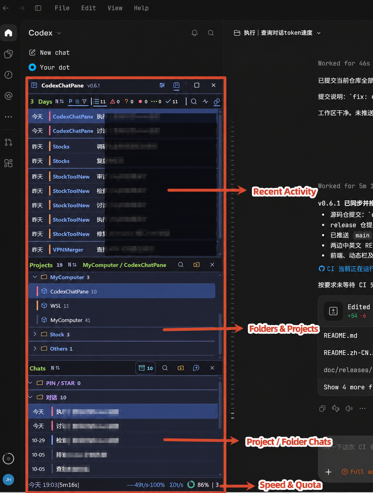

# CodexChatPane

[English](README.md) | [简体中文](README.zh-CN.md)

CodexChatPane is a chat sidebar for Codex Desktop on Windows. When you work on several projects at once, see which chats are running, which have finished, and which are waiting for your answer in one place. Click a chat title to return to Codex and continue the conversation. By default, the pane shows and hides with Codex. Position it alongside the Codex window to keep projects, chats, and quotas in the same workspace.

**[Download for Windows](https://github.com/tvivt/CodexChatPane/releases/latest)**

## Highlights

- **Quotas and consumption in one place**: Track 5h/W quota, reset history, Token usage and API-equivalent cost. Compare projects, chats and periods, with model breakdowns and separate subagent usage.
- **MCP operations without direct database edits**: Renaming, pinning, archiving and restoring use Codex's MCP tools. The app reads Codex's original databases without writing to them directly.
- **Lightweight local app**: A Rust backend uses file-change notifications, incremental reads, cached results and on-demand details to reduce repeated scans of chat histories.

## Recent activity · See which chats need attention

See chats from the last few days across projects. Status order puts unread errors first, followed by questions `?`, finished unread chats, running chats and read chats. Read chats use conversation time, newest first. Acknowledging an error retains its current diagnostic icon; recovery or a healthy next turn clears it.

Adjust the number of days, manually include or exclude chats, filter multiple projects, group by project, then sort by status or chat title.

Status icons use a single selection, with ALL selected by default. Click a state to show it, or ALL to show every state. The red warning icon filters chats with errors. Project filtering supports multiple selections. Search recent chat titles independently. P toggles the project column, with separate project sorting and filtering controls. Enable folder linkage to locate the selected chat immediately. On narrow panes, additional tools move into More while all six status controls remain visible.

## Projects · Organize work by project

Select a project to show its chats in the Chats pane. Status indicators beside each project help you see whether it has running chats, finished chats to review, or chats waiting for an answer.

Pin or star projects and organize them in folders. Chats without a project have their own entry.

## Chats · Find and continue a conversation

Search the current project's chats by title, organize frequent chats with folders, pins and stars, and use the context menu to rename, archive or restore them. Click a title to open the original chat in Codex. Enable chat previews in Settings when you want to read before opening.

Collapse and expand the Projects and Chats panes independently to keep the lists you need visible.

## Chat metrics and quota consumption

- **Selected-chat metrics**: The bottom bar shows values such as `1.8s·62t/s·93%`: first-token latency, estimated generation speed, and input cache hit rate. Σ is the estimated total speed of running chats; hover to see each chat's speed.
- **Turn details**: Open Chat details from the context menu to inspect each turn's model, input and output Tokens, cache usage and speed, along with activity counts, tools and subagents.
- **Quotas and periods**: Check remaining 5h/W quota, reset countdowns, reset-card counts and expiry information. Click the quota area for period history, quota remaining before each reset and each period's API-equivalent cost. It opens with the current period plus five recent periods, with ten more available at a time.
- **Usage and cost**: Trend charts use different colors for each model and switch between Tokens and API-equivalent cost. Summarize by project, chat or date, then expand a chat to inspect turns and subagent usage. Parent updates include descendant workers and refresh expanded details; selected time ranges still apply to each request. API-equivalent cost is an estimate, not your subscription bill.

## Get started

Requires Windows, Codex Desktop and WebView2 Runtime. The download is an unsigned portable executable. Open Codex Desktop, then run CodexChatPane to see local projects and chats. Use Settings to adjust the theme, language, font size and window mode.

This is an experimental personal project, not an official Codex Desktop component. Codex updates may affect compatibility.

## Documentation

| Topic | Document |
| --- | --- |
| User guide and settings | [Usage](doc/usage.md) |
| Complete feature index | [Documentation](doc/README.md) |
| Latency, speed, and statistics definitions (Chinese) | [Conversation metrics](doc/conversation-metrics.zh-CN.md) |
| Quotas, consumption, and cost estimates (Chinese) | [Usage and consumption](doc/usage-history.zh-CN.md) |
| v0.6.1 changes | [Release notes](doc/releases/v0.6.1.md) |
| Source setup, tests, and builds | [Development and validation](doc/development.md) |

## Local data and MCP operations

- The app opens Codex's original databases in read-only mode and does not directly edit them. Changes such as renaming, pinning, archiving and restoring go through Codex's MCP tools; enable write operations in settings before using them.
- Local folders, groups, themes, window settings and statistics caches are saved separately on your computer.
- The app does not upload or host your conversations.

## License

[MIT License](LICENSE)
