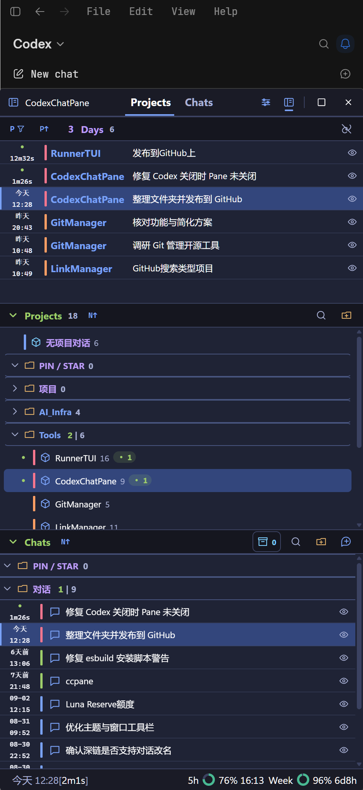

# CodexChatPane

[English](README.md) | [简体中文](README.zh-CN.md)

CodexChatPane is a Windows companion sidebar for Codex Desktop. It brings local projects, chats, activity, and usage limits into one searchable, organized window.

This is an experimental personal project, not an official Codex Desktop component. It does not upload or host your conversations.

## v0.5.1

[Release notes](doc/releases/v0.5.1.md) cover the Projects-only view, titlebar version, reset-card indicators, and faster archive readback. Archive from the context menu or restore with the archived chat's icon, without another confirmation. Download `CodexChatPane-v0.5.1.exe` from [GitHub Releases](https://github.com/tvivt/CodexChatPane/releases/tag/v0.5.1).

## Features

- Browse local Codex data by project, chat, recent activity, and archive status.
- Organize projects and chats with local folders and groups, including nested folders, search, sorting, selection, and drag and drop.
- See waiting-for-answer (`?`), unread, running, and error states, execution time, last activity, and usage limits; the Projects control collapses and restores both Projects and Chats.
- Select a chat to see first-token latency, estimated token speed, and cache hit rate; Chat details provide paged turn summaries, activity counts, tool totals, consumption, and separate subagent statistics.
- Σ sums recent weighted forecasts for running main chats, retaining estimates during tool waits and excluding current compaction. It shows `Σ≈125t/s`, `Σ0t/s`, or `Σ—`, without a silence timeout or OpenTelemetry receiver.
- Click quotas to open reset history: current period plus five ended periods, ten more per page. Consumption includes calendar/period ranges, model stacks, and project/day/chat breakdowns.
- Optionally enable conversation previews in settings (off by default); preview pages are read only when requested.
- Mark chats as always included in or excluded from recent activity; review both lists in the Activity rules dialog. Local stars are kept separately from Codex pins.
- Open or create conversations through Codex deep links.
- With your explicit consent, use Codex Desktop's internal App MCP to rename, pin, archive/restore chats or pin projects.
- Configure themes, language, font sizes, window mode, log level, and tool settings import/export.

## Screenshot



## Compatibility and status

- Windows only.
- Requires a working Codex Desktop installation. Its local data formats and internal MCP may change between versions.
- Windows releases are unsigned, portable executables built by GitHub Actions.
- The browser preview checks the static frontend; projects, chats, window integration, and Codex actions require the desktop runtime.

## Quick start from source

Requirements: Windows, Node.js/npm, Rust stable, and Codex Desktop.

```powershell
npm ci
npm run tauri dev
```

To preview only the frontend:

```powershell
npm run dev
```

The development server listens on `127.0.0.1:1420`. On first launch, the app reads local Codex data. Tool settings and folder state are stored in `%CODEX_HOME%\.codex-chat-pane\` (by default `%USERPROFILE%\.codex\.codex-chat-pane\`), outside this repository.

## Get the Windows executable

Pushing a matching `v*` tag in the public release repository builds and publishes `CodexChatPane-v<version>.exe`. A manual run of `Windows portable build` provides the `CodexChatPane-windows-portable` artifact. The executable is unsigned and needs WebView2 Runtime installed.

To build from source on Windows, run this from the repository root:

```powershell
powershell -NoProfile -ExecutionPolicy Bypass -File .\scripts\build-app.ps1
```

The development checkout's incremental script produces `.runtime/bin/CodexChatPane.exe`; the public release checkout's script runs validation and produces `release/CodexChatPane-v<version>.exe`. Installing an artifact and restarting the app are separate delivery steps. See [Development and validation](doc/development.md).

## Documentation

| Topic | Document |
| --- | --- |
| Complete feature index, terminology, and handoff order | [doc/README.md](doc/README.md) |
| Usage | [doc/usage.md](doc/usage.md) |
| Product behavior and data ownership | [doc/product.md](doc/product.md) |
| Code structure and data flow | [doc/architecture.md](doc/architecture.md) |
| Codex data, deep links, and App MCP | [doc/integration.md](doc/integration.md) |
| Conversation metrics definitions and implementation (Chinese) | [doc/conversation-metrics.zh-CN.md](doc/conversation-metrics.zh-CN.md) |
| Quota history, consumption, pricing, and caches (Chinese) | [doc/usage-history.zh-CN.md](doc/usage-history.zh-CN.md) |
| Development, tests, and builds | [doc/development.md](doc/development.md) |

## Validation

```powershell
npm run build
node tests/frontend.mjs
node tests/dynamic.mjs
cargo fmt --manifest-path src-tauri/Cargo.toml --check
cargo test --manifest-path src-tauri/Cargo.toml --locked
```

A few Rust tests that require real local Codex data are explicitly ignored by default.

## Data and safety

- Codex state, history, rollout, and log files are opened read only.
- Conversation text and activity details are read on demand for previews and metrics; they are not stored in this app's snapshots or settings.
- Folders, groups, themes, and window settings stay local and are not synced to the cloud by this app.
- Rename, pin, and archive operations require you to enable Codex MCP. The app reloads state after each operation to verify the result.
- Codex Desktop's internal App MCP is not a stable public API. Changes to it may temporarily disable write operations without affecting read only browsing.
- Startup renders metadata before deferred activity. Neither startup nor a quota query indexes all Token history. Rebuildable caches stay in the app's own data directory; forecast phases remain in memory.

## License

[MIT License](LICENSE)
