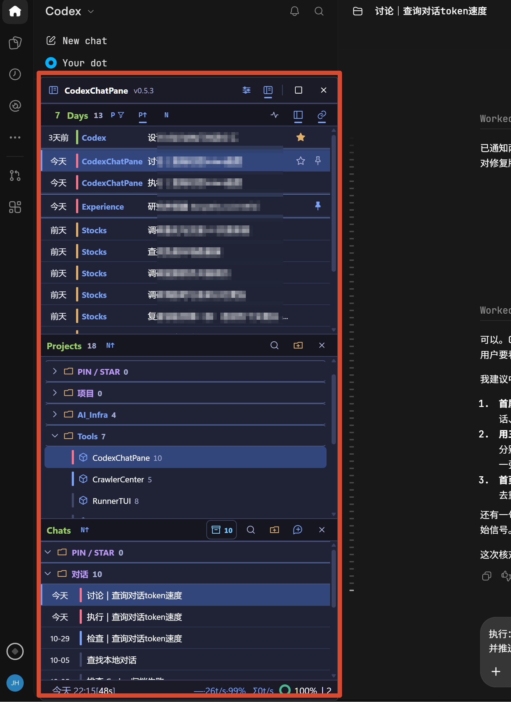

# CodexChatPane

[English](README.md) | [简体中文](README.zh-CN.md)

CodexChatPane is a chat sidebar for Codex Desktop on Windows. When you work on several projects at once, see which chats are running, which have finished, and which are waiting for your answer in one place. Click a chat title to return to Codex and continue the conversation. By default, the pane shows and hides with Codex. Position it alongside the Codex window to keep projects, chats, and quotas in the same workspace.

**[Download for Windows](https://github.com/tvivt/CodexChatPane/releases/latest)**

## Recent activity · See which chats need attention

See chats from the last few days across projects. When sorted by status, chats waiting for an answer appear first with `?`, followed by finished chats you have not viewed, running chats, and read chats.

Adjust the number of days, manually include or exclude chats, filter multiple projects, group by project, then sort by status or chat title.

## Projects · Organize work by project

Select a project to show its chats in the Chats pane. Status indicators beside each project help you see whether it has running chats, finished chats to review, or chats waiting for an answer.

Pin or star projects and organize them in folders. Chats without a project have their own entry.

## Chats · Find and continue a conversation

Search the current project's chats by title, organize frequent chats with folders, pins and stars, and use the context menu to rename, archive or restore them. Click a title to open the original chat in Codex. Enable chat previews in Settings when you want to read before opening.

Collapse and expand the Projects and Chats panes independently to keep the lists you need visible.

## Chat statistics and quotas

- **Selected-chat metrics**: The bottom bar shows values such as `1.8s·62t/s·93%`: first-token latency, estimated generation speed, and input cache hit rate. Σ is the estimated total speed of running chats; hover to see each chat's speed.
- **Turn details**: Open Chat details from the context menu to inspect each turn's model, input and output Tokens, cache usage and speed, along with activity counts, tools and subagents.
- **Quotas and periods**: Check remaining 5h/W quota, reset countdowns, reset-card counts and expiry information. Click the quota area for period history and quota remaining before each reset. It opens with the current period plus five recent periods, with ten more available at a time.
- **Usage and cost**: Trend charts use different colors for each model and switch between Tokens and API-equivalent cost. Summarize by project, chat or date, then expand a chat to inspect turns and subagent usage. API-equivalent cost is an estimate, not your subscription bill.

## Get started

Requires Windows, Codex Desktop and WebView2 Runtime. The download is an unsigned portable executable. Open Codex Desktop, then run CodexChatPane to see local projects and chats. Use Settings to adjust the theme, language, font size and window mode.

This is an experimental personal project, not an official Codex Desktop component. Codex updates may affect compatibility.

## Documentation

| Topic | Document |
| --- | --- |
| User guide and settings | [Usage](doc/usage.md) |
| Complete feature index | [Documentation](doc/README.md) |
| Latency, speed, and statistics definitions (Chinese) | [Conversation metrics](doc/conversation-metrics.zh-CN.md) |
| Quotas, consumption, and cost estimates (Chinese) | [Usage and consumption](doc/usage-history.zh-CN.md) |
| v0.5.4 changes | [Release notes](doc/releases/v0.5.4.md) |
| Source setup, tests, and builds | [Development and validation](doc/development.md) |

## Data and safety

- The app does not upload or host your conversations. Browsing does not modify the original Codex conversations.
- Folders, groups, themes, and window settings stay local.
- Renaming, pinning, and archiving change Codex state; enable write operations in settings before using them.

## License

[MIT License](LICENSE)
