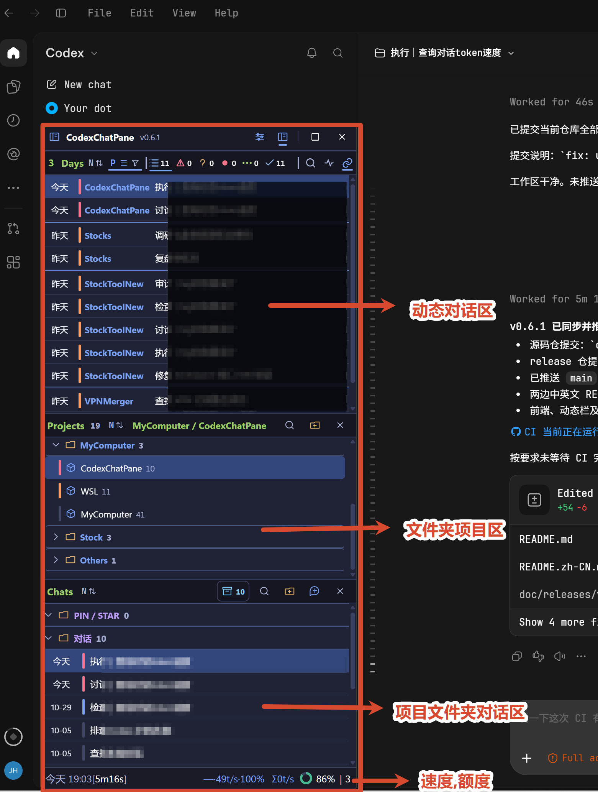

# CodexChatPane

[English](README.md) | [简体中文](README.zh-CN.md)

CodexChatPane 是为 Windows 版 Codex Desktop 做的对话侧栏。多个项目同时开工时，可以在一处看到哪些对话还在运行、哪些已经完成、哪些正等你回答。点击对话标题，就能回到 Codex 继续聊。面板默认随 Codex 显隐，可贴合 Codex 窗口摆放，把项目、对话和额度放在同一工作界面中。

**[下载 Windows 版](https://github.com/tvivt/CodexChatPane/releases/latest)**

## 功能与特点

- **额度与消耗一处查看**：跟踪 5h/W 额度、重置历史、Token 用量和 API 等价金额；按项目、对话或周期汇总，拆分模型构成，单独查看子代理用量。
- **通过 MCP 操作，不直接改数据库**：改名、Pin、归档和恢复使用 Codex 的 MCP 工具；对 Codex 原始数据库只读访问，不直接写入修改。
- **轻量本地运行**：Rust 后端结合文件变化通知、增量读取、本地缓存和详情按需加载，减少反复扫描完整对话历史带来的开销。

## 动态栏 · 看最近哪些对话需要处理

跨项目显示最近几天的对话。按状态排序时，未读错误优先，其次是待回答 `?`、已完成待查看、工作中和已读；已读组按对话时间倒序。错误已读后保留当前诊断标识，解除或下一轮正常时清除。

可调整显示天数，手动加入或移出对话，过滤多个项目，按项目分组，再按状态或对话名称排序。

状态图标采用单选，默认 ALL 显示全部，点击单项只显示对应状态，红色警告图标筛选出错对话；项目过滤继续支持多选。动态栏可独立搜索对话标题，P 控制项目列显隐，旁边的项目排序和筛选分别操作。开启文件夹联动会立即定位当前对话。窄栏将更多工具收进菜单，六个状态控件始终可见。

## 项目区 · 按项目整理工作

选中项目后，对话区会联动显示该项目的对话。项目旁的状态提示，方便你查看这个项目是否有正在运行、已完成待查看或等待回答的对话。

支持置顶、加星和文件夹整理；没有所属项目的对话，也有独立入口。

## 对话区 · 找到并继续一个对话

按标题搜索当前项目的对话，用文件夹、置顶和加星整理常用对话，通过右键菜单重命名、归档或恢复。点击标题会在 Codex 中打开原对话；需要先看内容时，可在设置中开启对话预览。

Projects 和 Chats 两个栏可以独立收起、展开，按当前工作保留需要的列表。

## 对话指标与额度消耗统计

- **当前对话指标**：选中对话后，底部会显示类似 `1.8s·62t/s·93%` 的指标，分别表示首字延迟、估算生成速度和输入缓存命中率。Σ 表示运行中对话的估算总速度，悬停可查看各对话的速度。
- **逐轮详情**：右键打开“对话详情”，逐轮查看模型、输入和输出 Token、缓存及速度，也可查看活动记录数、工具和子代理。
- **额度与周期**：查看 5h/W 剩余额度、重置倒计时、重置卡数量和到期信息。点击额度区域查看周期历史、重置前剩余额度及各周期 API 等价金额；默认显示当前周期和最近 5 条历史，每次可再加载 10 条。
- **用量与金额**：趋势图以不同颜色区分模型，支持切换 Token 与 API 等价金额；可按项目、对话、日期汇总，展开对话查看轮次及子代理用量。主对话更新会包含所属下级子代理，并同步刷新已展开明细；每笔请求仍受所选时间范围限制。API 等价金额是估算，不是订阅账单。

## 开始使用

需要 Windows、Codex Desktop 和 WebView2 Runtime，下载程序为未签名的便携版 EXE。打开 Codex Desktop 后运行 CodexChatPane，即可查看本机项目和对话；在设置中可调整主题、语言、字号和窗口模式。

这是个人项目的实验版本，并非 Codex Desktop 官方组件；Codex 更新可能影响兼容性。

## 文档

| 目的 | 文档 |
| --- | --- |
| 操作入口与设置 | [使用说明](doc/usage.zh-CN.md) |
| 完整功能目录 | [文档总览](doc/README.md) |
| 首字、速度和统计口径 | [对话指标](doc/conversation-metrics.zh-CN.md) |
| 额度、消耗和金额估算 | [额度与消耗](doc/usage-history.zh-CN.md) |
| v0.6.1 改动 | [发布说明](doc/releases/v0.6.1.md) |
| 源码环境、测试与构建 | [开发与验证](doc/development.zh-CN.md) |

## 本地数据与 MCP 操作

- 对 Codex 原始数据库只读访问，不直接改写；改名、Pin、归档和恢复等状态变更均通过 Codex 的 MCP 工具完成，使用前需在设置中启用写操作。
- 本地文件夹、分组、主题、窗口设置和统计缓存独立保存在本机。
- 本工具不上传或托管对话。

## License

[MIT License](LICENSE)
