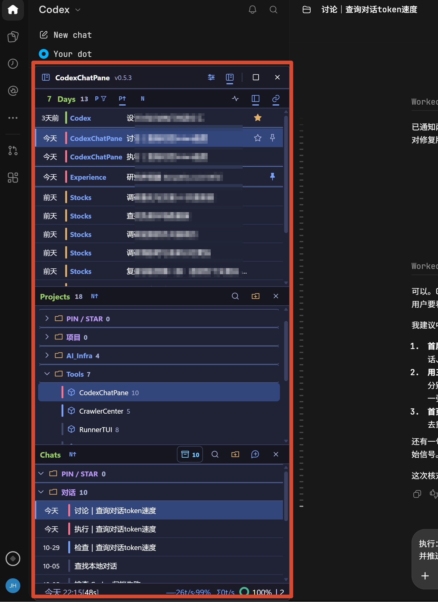

# CodexChatPane

[English](README.md) | [简体中文](README.zh-CN.md)

CodexChatPane 是 Codex Desktop 的 Windows 辅助侧栏，帮你找对话、看进度、查消耗。

**[下载 Windows 版](https://github.com/tvivt/CodexChatPane/releases/latest)**

## 找对话

- 在最近动态、Projects 和 Chats 中查找对话，支持搜索和排序。
- 用文件夹、分组、收藏、多选和拖动整理项目与对话，把常用工作放在顺手的位置。
- 打开或新建对话，也可通过右键菜单改名、Pin、归档或恢复；对话预览可在设置中开启。

## 看进度

- 查看执行中、待回答（`?`）、未读和错误状态，以及执行耗时和最近活动。
- 选中对话后，在底部状态栏查看首字延迟、生成速度和缓存命中率；点击指标或通过右键菜单打开“对话详情”，查看轮次摘要、活动记录数、工具和子代理。
- 通过 Σ 查看当前运行对话的预估总速度。

## 查消耗

- 点击底部额度区域打开“重置记录”：显示当前周期和最近 5 条历史，每次可再加载 10 条。
- 切换到“消耗”，按周期、日期、项目、对话或模型查看 Token 用量和 API 等价金额。
- API 等价金额是估算，不是订阅账单；具体口径见[额度与消耗](doc/usage-history.zh-CN.md)。

## v0.5.4

- 额度周期从首次使用开始，历史行显示结束该周期的重置方式。
- 缺少观测时，明确显示“自然重置(待确认)”及预计时间。
- 晚到证据修正后，周期选择、持续时间、Token 和金额合计一起更新。

详见 [v0.5.4 说明](doc/releases/v0.5.4.md)；Windows 下载附件见 [GitHub Releases](https://github.com/tvivt/CodexChatPane/releases)。

## 兼容性与当前状态

- 需要 Windows、Codex Desktop 和 WebView2 Runtime。
- 下载程序为未签名的便携版 EXE。
- 这是个人项目的实验版本，并非 Codex Desktop 官方组件；Codex 更新可能影响兼容性。

## 开始使用

1. 从[最新版本](https://github.com/tvivt/CodexChatPane/releases/latest)下载 EXE。
2. 打开 Codex Desktop，再运行 CodexChatPane，侧栏会读取本机项目和对话。
3. 选中对话、整理列表，或打开设置调整主题、语言、字号和窗口模式。

## 文档

| 目的 | 文档 |
| --- | --- |
| 操作入口与设置 | [使用说明](doc/usage.zh-CN.md) |
| 完整功能目录 | [文档总览](doc/README.md) |
| 首字、速度和统计口径 | [对话指标](doc/conversation-metrics.zh-CN.md) |
| 额度、消耗和金额估算 | [额度与消耗](doc/usage-history.zh-CN.md) |
| v0.5.4 改动 | [发布说明](doc/releases/v0.5.4.md) |
| 源码环境、测试与构建 | [开发与验证](doc/development.zh-CN.md) |

## 数据与安全边界

- 本工具不上传或托管对话；仅浏览不会修改 Codex 原始对话。
- 文件夹、分组、主题和窗口设置保存在本机。
- 改名、Pin、归档会改变 Codex 中的状态，使用前需在设置中启用写操作。

## License

[MIT License](LICENSE)
