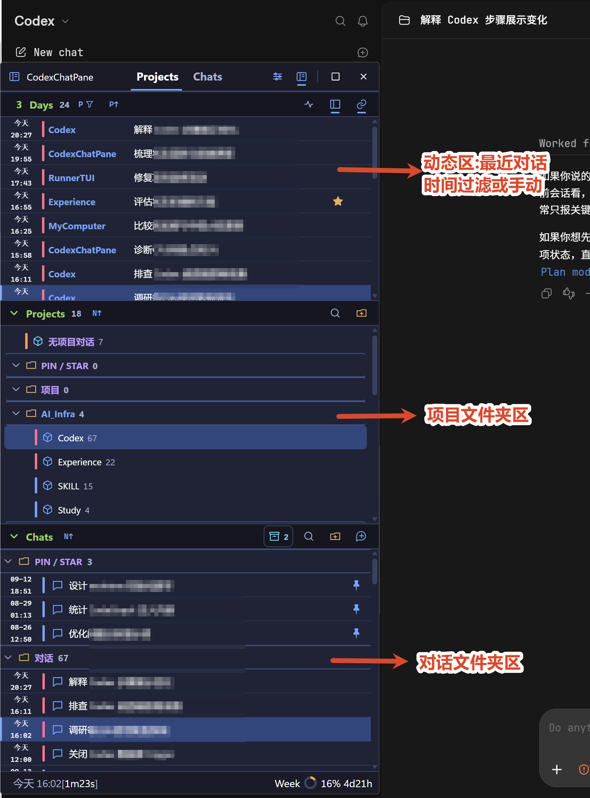

# CodexChatPane

[English](README.md) | [简体中文](README.zh-CN.md)

CodexChatPane 是一个运行在 Windows 上的 Codex Desktop 辅助侧栏：把本机 Codex 的 Project、Chat、运行状态和额度集中到一个可筛选、可分组的窗口中。

这是一个个人项目的实验性源码版本，不是 Codex Desktop 的官方组件，也不上传或托管对话数据。

## v0.5.0

本版包含额度周期修复、对话详情分页、消耗计价、速度 tips 和 Projects/Chats 联动调整，详见[发布说明](doc/releases/v0.5.0.md)。从 [GitHub Releases](https://github.com/tvivt/CodexChatPane/releases/tag/v0.5.0) 下载 `CodexChatPane-v0.5.0.exe`。

## 功能概览

- 按 Project、Chat、最近活动和归档状态浏览本机 Codex 数据。
- 使用本地 Folder 和 Group 整理 Project、Chat；支持多级文件夹、搜索、排序、多选和拖动。
- 显示待回答（`?`）、未读、执行中、错误、执行时间、最后活动时间和额度状态；Projects 按钮同时收起或展开 Projects/Chats。
- 点击对话显示首 token、估算 token 速度和缓存命中率；“对话详情”提供分页轮次摘要、活动记录数、工具汇总、消耗和独立子代理统计。
- Σ 合计运行中主对话的近期加权预测速度，工具等待时保留预测，当前压缩时排除；显示 `Σ≈125t/s`、`Σ0t/s` 或 `Σ—`，无静默超时归零，不接入 OpenTelemetry。
- 点击额度默认打开重置记录：当前周期＋最近 5 条历史，每次加载更多 10 条。消耗页提供周期多选、自然时间、模型堆叠趋势和项目/日期/对话拆分。
- 可在设置中开启对话预览（默认关闭）；使用预览入口时才分页读取 rollout 内容。
- 可将对话始终加入或移出最近动态，并在“动态规则”对话框集中查看；工具 Star 与 Codex Pin 分开保存。
- 通过 Deep Link 打开已有对话或新建对话。
- 在用户明确同意后，通过 Codex Desktop 内部 App MCP 修改对话名称、Pin、归档/恢复和 Project Pin。
- 提供主题、语言、字号、窗口模式、日志级别和工具配置导入/导出。

## 界面预览



## 兼容性与当前状态

- Windows only。
- 需要可正常运行的 Codex Desktop；Codex 的本地数据结构和内部 MCP 可能随版本变化。
- Windows 发布由 GitHub Actions 构建，提供未签名的便携单文件可执行程序。
- 浏览器预览可以检查静态前端，但 Project、Chat、窗口联动和 Codex 操作需要桌面运行时。

## 快速开始

前置条件：Windows、Node.js/npm、Rust stable，以及 Codex Desktop。

```powershell
npm ci
npm run tauri dev
```

只启动前端预览：

```powershell
npm run dev
```

开发服务器监听 `127.0.0.1:1420`。首次启动时，应用会读取本机 Codex 数据；本地工具设置和 Folder 状态写入 `%CODEX_HOME%\.codex-chat-pane\`（默认 `%USERPROFILE%\.codex\.codex-chat-pane\`），不会写入仓库。

## 获取 Windows 可执行文件

在公开发布仓库推送与版本匹配的 `v*` 标签，会构建并发布 `CodexChatPane-v<version>.exe`。手动运行 `Windows portable build` 可取得 `CodexChatPane-windows-portable` 构建产物。当前构建未签名，程序依赖系统已安装 WebView2 Runtime。

从源码在 Windows 本地构建，在仓库根目录运行：

```powershell
powershell -NoProfile -ExecutionPolicy Bypass -File .\scripts\build-app.ps1
```

开发仓库使用增量构建脚本，生成 `.runtime\bin\CodexChatPane.exe`；公开发布仓库的脚本执行验证后生成 `release\CodexChatPane-v<version>.exe`。覆盖安装目录和重启属于单独交付步骤。环境要求、版本来源和核验步骤见 [开发与验证](doc/development.zh-CN.md)。

## 文档

| 目的 | 文档 |
| --- | --- |
| 全功能目录、术语和接手阅读顺序 | [doc/README.md](doc/README.md) |
| 怎么使用 | [doc/usage.zh-CN.md](doc/usage.zh-CN.md) |
| 理解产品行为和数据所有权 | [doc/product.zh-CN.md](doc/product.zh-CN.md) |
| 理解代码结构和数据流 | [doc/architecture.zh-CN.md](doc/architecture.zh-CN.md) |
| 理解 Codex 数据、Deep Link 和 App MCP | [doc/integration.zh-CN.md](doc/integration.zh-CN.md) |
| token 速度定义、日志解析与对话统计实现 | [doc/conversation-metrics.zh-CN.md](doc/conversation-metrics.zh-CN.md) |
| 额度周期、通知、消耗计价、筛选和历史缓存 | [doc/usage-history.zh-CN.md](doc/usage-history.zh-CN.md) |
| 修改、测试和构建项目 | [doc/development.zh-CN.md](doc/development.zh-CN.md) |

## 验证

```powershell
npm run build
node tests/frontend.mjs
node tests/dynamic.mjs
cargo fmt --manifest-path src-tauri/Cargo.toml --check
cargo test --manifest-path src-tauri/Cargo.toml --locked
```

Rust 测试中有少量显式忽略的本机 Codex 数据检查；它们需要真实 Codex 环境或对应环境变量，不属于默认回归。

## 数据与安全边界

- Codex 状态库、历史库、rollout 和日志以只读方式读取。
- 预览和统计详情按需读取对话正文、活动摘要，不写入本项目的快照或配置。
- Folder、Group、主题和窗口设置属于本地工具状态，不同步到云端。
- 改名、Pin、归档等写操作需要用户启用 Codex MCP，并在每次操作后重新加载状态验证结果。
- Codex Desktop 内部 App MCP 不是公开稳定接口；接口变化可能使写操作暂时不可用，但不影响只读浏览。
- 列表先读目录元数据，后台补状态；不因启动或额度查询索引所有 Token。持久缓存只写 App 自己的目录，预测阶段只在内存中存在。

## License

[MIT License](LICENSE)
